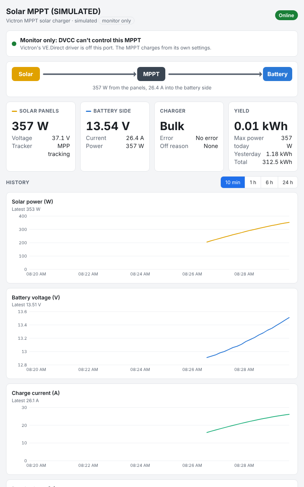

# Victron-Cerbo-monitor-a-MPPT-without-DVCC

[](https://github.com/CKOCI13/Victron-Cerbo-monitor-a-MPPT-without-DVCC/actions/workflows/tests.yml)
[](LICENSE)

**See a Victron MPPT solar charger on a Cerbo GX screen, an Android tablet and VRM, without letting the Cerbo
control it.** Plug the MPPT into the Cerbo with a VE.Direct cable as usual. This monitor then reads it and
shows its readings, while the MPPT keeps charging from its own settings. The Cerbo's **DVCC** can't change it.



> [!NOTE]
> **Monitor only.** The monitor opens the VE.Direct port read-only, so it can't send the MPPT anything.
> It has been tested in software (unit tests, a pretend MPPT, and checks against Victron's own source code),
> but **not yet on a real MPPT and Cerbo**. The [test plan](#check-that-it-works) below shows how to confirm it
> on yours. This project isn't made by, or affiliated with, Victron Energy.

---

## Contents

- [The problem](#the-problem)
- [How this solves it](#how-this-solves-it)
- [What it shows](#what-it-shows)
- [What you need](#what-you-need)
- [Where the MPPT sits in an LTV1](#where-the-mppt-sits-in-an-ltv1)
- [Before you start: set up the MPPT itself](#before-you-start-set-up-the-mppt-itself)
- [Try it on your PC in one minute](#try-it-on-your-pc-in-one-minute)
- [Installing it](#installing-it)
- [Check that it works](#check-that-it-works)
- [Optional: a one-way cable](#optional-a-one-way-cable)
- [The temperature probe](#the-temperature-probe)
- [Living alongside the Nomadic D1 monitor](#living-alongside-the-nomadic-d1-monitor)
- [FAQ](#faq)
- [For developers](#for-developers)
- [License and credits](#license-and-credits)

## The problem

When you plug a Victron MPPT into a Cerbo GX with a VE.Direct cable, the Cerbo's own driver registers it as a
**solar charger**. If **DVCC** (Distributed Voltage and Current Control) is on, the Cerbo then takes over the
MPPT's charging. It sends the MPPT a charge voltage and current, and the MPPT shows **"External control"**. With a
managed battery on CAN, such as a Lithionics, the Cerbo switches DVCC on by itself and may lock it.

Victron has no setting to leave one MPPT out of DVCC. If you want to *see* the MPPT on the Cerbo but have it
charge only from its own settings, you need something else. That's what this is.

In a Grand Design LTV1 this matters even more. The MPPT charges the **12 V AGM chassis batteries**, not the
51 V Lithionics house battery. DVCC assumes every solar charger feeds the battery its BMS manages, so it would
apply the Lithionics' charge limits to an MPPT that is on a different battery.

## How this solves it

Three separate layers keep the MPPT out of the Cerbo's control:

1. **Victron's driver is stopped on that one port.** Venus OS's `serial-starter` starts Victron's VE.Direct driver
   on every VE.Direct port. The monitor asks it, with Victron's own `stop-tty.sh`, to stop that driver on the
   MPPT's port only. Your other VE.Direct ports are untouched. The monitor checks every 10 seconds that the driver
   stays off, asks again if it comes back, and shows the result on the **Control** tile.
2. **It isn't a solar charger any more.** The monitor shows the MPPT as a **DC source**, a kind of DC meter.
   In Victron's code (`dbus-systemcalc-py`, `delegates/dvcc.py`), DVCC only controls solar chargers,
   inverter/chargers, alternators and DC gensets, so it never controls a DC source. A setting that would
   register it as one of those is refused.
3. **The port is opened read-only.** The operating system itself refuses any attempt to write to it. The code
   has no write function, and an automated test fails if anyone adds one.

**The one gap: the first seconds after each Cerbo start.** Victron's driver starts at boot, slightly before
the monitor does. In that short window it can find the MPPT, and DVCC can send it a limit. The monitor then
stops the driver, and the MPPT goes back to its own settings once the Cerbo stops sending. Step 6 of the
[test plan](#check-that-it-works) checks this on your system. The [one-way cable](#optional-a-one-way-cable)
closes the gap completely.

## What it shows

- **On the Cerbo's screen**, as cards in the **switch pane**:
  - **Solar MPPT:** Control (monitor only, or a red warning), State (Bulk, Absorption, Float…), Error,
    Yield today, Max power today. Yield yesterday, Yield total and Tracker are hidden at first, and you can show
    them from the device page.
  - **Solar MPPT solar:** panel voltage and power.
  - **Solar MPPT battery:** battery voltage, charge current and power.
- **In the device list** as "Solar MPPT", and as a **DC source** box on the Overview page.
- **In VRM:** the cards appear in the **Switches** panel of the VRM portal and the Switches widget of the app.
- **Its own web page** at `http://<cerbo-address>:8090`. Any tablet, phone or laptop on the same network can open
  it. It shows live values, the Control status, yields, error explanations, and charts of the last 24 hours.

## What you need

| | |
|---|---|
| **MPPT** | A Victron MPPT solar charger with a VE.Direct port (BlueSolar or SmartSolar) |
| **Victron device** | A Cerbo GX running **Venus OS v3.80 or newer** (for the switch pane and VRM Switches) |
| **Cable** | A Victron **VE.Direct cable**, straight (ASS030530xxx) or right-angle (ASS030531xxx), up to 10 m. It can't be extended. A VE.Direct-to-USB cable into a Cerbo USB port works too |
| **A computer** | Windows, for the [`Cerbo Setup.bat`](Cerbo%20Setup.bat) helper. On Mac or Linux, use the commands in the [driver reference](dbus-mppt-monitor/README.md). Or install from a USB stick with no computer connection at all |

The MPPT uses its only VE.Direct port for this cable, so you can't also plug in an MPPT Control display. The
tablet takes its place.

## Where the MPPT sits in an LTV1

- **What it charges:** the two **12 V AGM chassis batteries**, wired in parallel under the driver's seat. They
  power the chassis and start the van. The MPPT is wired to the **rear 12 V bus bar**, which is cabled to them.
- **Where extra solar goes:** once the chassis batteries are full, the Nomadic **D1** takes the surplus from the
  12 V bus bar and boosts it to charge the **51 V Lithionics** house battery. The MPPT never connects to the
  Lithionics directly.
- **Make the D1 and the MPPT settings fit together.** Surplus solar only reaches the D1 once the 12 V bus is above
  the voltage at which the D1 starts boosting. If that voltage is **higher than the MPPT's float voltage**, the MPPT
  simply throttles back in Float and no solar reaches the house battery. If it is **well below the MPPT's
  absorption voltage**, the D1 keeps pulling the bus down and the AGMs may never get a full absorption charge.
  Check the D1's boost start voltage against the absorption and float voltages you set in step 2 below.
- **Shared ground.** A VE.Direct cable (the one-way cable too) carries a **ground wire** between the MPPT and the
  Cerbo. The MPPT's negative is the 12 V side, which returns through the Ford chassis grounds. If the Cerbo is
  powered from the house-battery side, confirm that the 51 V (48 V nominal) negative and the chassis negative are joined (for example
  through the D1) before plugging in the cable. If they aren't, ask Victron before connecting.

## Before you start: set up the MPPT itself

With DVCC out of the picture, **the MPPT's own settings are the only thing deciding how it charges**. AGM
batteries have no BMS to protect them, so set the MPPT up properly in **VictronConnect** first:

1. **Battery voltage:** switch off auto-detect and set it to **12 V**.
2. **Battery preset / charge voltages:** use the AGM battery maker's absorption and float voltages (on the battery
   label or data sheet). If you have no figures, VictronConnect's AGM preset is a reasonable start. Keep the
   maximum charge current within what the batteries' maker allows.
3. **Temperature compensation:** leave lead-acid temperature compensation **on** (Victron's default for 12 V is
   about −16 mV per °C). AGMs need lower charge voltages when warm and higher when cold. By default the MPPT
   uses its **own internal temperature**, and in an LTV1 it sits at the rear while the batteries are under the
   driver's seat. A Victron **Smart Battery Sense** on the batteries (over Bluetooth, VE.Smart network) gives it
   the real battery temperature. The Cerbo's temperature probe can't, because DVCC is what would pass it on.

## Try it on your PC in one minute

You can see the monitor working without a Cerbo or an MPPT. It includes a **pretend MPPT** that sends real
VE.Direct messages. You need [Python 3](https://www.python.org/downloads/).

```bash
git clone https://github.com/CKOCI13/Victron-Cerbo-monitor-a-MPPT-without-DVCC.git
cd Victron-Cerbo-monitor-a-MPPT-without-DVCC
python dbus-mppt-monitor/dbus-mppt-monitor.py --simulate --no-dbus
```

Open **<http://localhost:8091>**. A pretend day lasts 20 minutes, with 4 minutes of night: the sun rises and sets,
the battery goes through Bulk, Absorption and Float, and the yields count up. Press **Ctrl+C** to stop.
(No Git? Click the green **Code** button, then **Download ZIP**, unzip it, and run the last line inside the
unzipped folder. On Mac or Linux, type `python3` instead of `python`.)

## Installing it

The **[Installation and User Guide (PDF)](docs/installation-guide.pdf)** covers all of this step by step, with a
printable checklist. In short:

1. **Set up the MPPT** as described [above](#before-you-start-set-up-the-mppt-itself).
2. **Plug the VE.Direct cable** into the MPPT and into any of the Cerbo's three VE.Direct ports. These are not
   the RJ45 VE.Can or VE.Bus sockets. For a few minutes the Cerbo's own driver will show it as a solar charger.
   That's expected, and is how the monitor finds it.
3. **Allow your PC to connect to the Cerbo:** on the Cerbo, *Settings › General › Access level* → **Superuser**
   (set a root password when asked), then *Settings › General › SSH on LAN* → **On**.
4. **Run [`Cerbo Setup.bat`](Cerbo%20Setup.bat)** on your Windows PC and type the Cerbo's IP address
   (*Settings › Connectivity › Ethernet* or *Wi-Fi*).
   - **Option 2** shows the VE.Direct ports and what is on each. Your MPPT should appear with its serial number.
   - **Option 1** opens the settings. Leave `port = auto` unless you have more than one MPPT. Then set
     `serial_number` to the MPPT you want monitored; the others stay with Victron's driver.
   - **Option 4** installs the monitor and starts it.
5. **[Check that it works.](#check-that-it-works)**

After installing, the monitor starts by itself whenever the Cerbo starts, including after firmware updates.

### Installing from a USB stick or SD card (no network needed)

1. Download **`venus-data-mppt-monitor.tar.gz`** from the [latest release](https://github.com/CKOCI13/Victron-Cerbo-monitor-a-MPPT-without-DVCC/releases/latest).
   It has the standard settings, with `port = auto`.
   (On a Mac, download with Chrome or Firefox: Safari can unpack it into a `.tar` file, which the Cerbo ignores.)
2. Copy it to the top folder of a USB stick or SD card (FAT32 is the safe choice), not inside another folder.
   Put only one `venus-data` file on the stick, and make sure its name has no ` (1)` added.
3. On the Cerbo, check *Settings › General › Modification checks*: modifications must be enabled (the default).
4. Put the stick in the Cerbo and restart it (*Settings › General › Reboot*).
5. Wait about 2 minutes, then take the stick out. The Cerbo renames the file on the stick to `...tar.gz.installed`,
   so it never installs twice.

To use different settings, edit [`dbus-mppt-monitor/config.ini`](dbus-mppt-monitor/config.ini) and make your own
file: `Cerbo Setup.bat` option **U** on Windows, or `sh make-usb-installer.sh` on Mac or Linux.

## Check that it works

Do this once after installing, in daylight if you can. None of these steps can change the MPPT.

| # | Where | What to check |
|---|---|---|
| 1 | Cerbo switch pane | A **Solar MPPT** card, with **Control: Monitor only (DVCC can't reach it)**. A red **Victron driver active!** that stays for more than a minute means Victron's driver keeps coming back: see the log (`Cerbo Setup.bat` option 5) |
| 2 | Cerbo › Settings › Devices | The MPPT appears **once**, as **Solar MPPT** (a DC source), and **not** as a solar charger |
| 3 | Cerbo switch pane / web page | Battery voltage within about 0.1–0.2 V of the 12 V chassis bus (the D1 monitor's 12 V reading, or a meter on the rear bus bar), and panel power above zero in daylight |
| 4 | VictronConnect, on the MPPT (Bluetooth) | Wait 5 minutes after installing. The state should be **Bulk, Absorption or Float**, not **External control** |
| 5 | Cerbo › Settings › System setup › Charge control | Whatever DVCC shows, the MPPT isn't among the devices it controls any more (step 2) |
| 6 | Restart the Cerbo, then repeat steps 1, 2 and 4 | Checks the start-up gap: 5 minutes after the restart, the MPPT must not be in External control |

If step 4 or 6 shows **External control** for more than a few minutes, please open an [issue](../../issues) with
the monitor's log. Uninstall it (`Cerbo Setup.bat` option 8) until it's sorted, and leave the VE.Direct cable
unplugged.

## Optional: a one-way cable

For a guarantee in hardware, so that nothing on the Cerbo can ever send the MPPT anything (even in the
start-up seconds), use a cable that only carries data **from** the MPPT **to** the Cerbo.

A VE.Direct connector has 4 pins (Victron's *VE.Direct protocol* document):
**1** ground, **2** RX (data **into** the MPPT), **3** TX (data **out of** the MPPT), **4** power.

The safest way is a short 4-pin JST-PH extension lead between the VE.Direct cable and the MPPT, so the Victron
cable stays intact. At the MPPT end, cut and insulate the wire on **pin 2 only**. Then:

- In `config.ini`, set `port` to the port's name (for example `ttyS6`, as Option 2 shows it) instead of `auto`.
  Victron's driver may not recognise a one-way MPPT, so `auto` may never find it.
- Check with `Cerbo Setup.bat` option 3 that readings still arrive. If they stop, the wrong wire was cut: pin 3
  carries the readings. Cutting either data wire can't damage anything.

## The temperature probe

The Cerbo's temperature inputs are separate from this monitor. Use Victron's **ASS000001000** temperature sensor
on one of the Cerbo's four temperature inputs: red wire to the top terminal, black to the bottom. Then switch the
input on under *Settings › Integrations › Tank and Temperature Sensors*. It shows in the Cerbo's temperature unit,
so in **°F** if the Cerbo is set to Fahrenheit.

The MPPT can't use that probe. The Cerbo would only pass it on through DVCC's "Shared temperature sense", and only
to solar chargers, which this MPPT no longer is. So it stays a reading on the screen, which is what you want here.

## Living alongside the Nomadic D1 monitor

This is a separate project from [cerbo-nomadic-d1-monitor](https://github.com/CKOCI13/cerbo-nomadic-d1-monitor),
and the two run side by side on the same Cerbo without touching each other:

| | Nomadic D1 monitor | This MPPT monitor |
|---|---|---|
| Connection | CAN (VE.Can port 2) | VE.Direct |
| Folder on the Cerbo | `/data/dbus-nomadic-dcdc` | `/data/dbus-mppt-monitor` |
| Service | `dbus-nomadic-dcdc` | `dbus-mppt-monitor` |
| Device instance | 70 | 71 |
| Web page | port 8088 | port 8090 |

Both add one line each to `/data/rc.local`, and leave the other's line alone.

## FAQ

**Will this change my DVCC settings?**
No. The monitor never writes any Cerbo setting. DVCC stays as it is, and keeps doing whatever it does for your other
devices. It just has no MPPT to control.

**Can I still change the MPPT's settings?**
Yes, with VictronConnect over Bluetooth, as before. Changing them over VRM ("VictronConnect Remote") no longer works
for this MPPT, because that goes through Victron's driver.

**Does the MPPT still show in VRM?**
Its cards appear in VRM's **Switches** panel and widget. It's no longer a "solar charger" in VRM, so VRM's own
solar widgets and solar yield reports won't include it. The monitor's web page keeps 24 hours of charts.

**I have a Firefly TruState shunt on the MPPT output. Is that a problem?**
No. The shunt reports to the Firefly system, not to the Cerbo, and the monitor doesn't use it.

**How do I give the MPPT back to the Cerbo?**
`Cerbo Setup.bat` option 8, then restart the Cerbo. Victron's driver takes the port back on the next start.

**Why are the charts empty after a restart?**
The history is kept in memory, so it starts again whenever the monitor or the Cerbo restarts.

## For developers

- Plain **Python 3**, standard library only, plus what every Victron GX device already has (`dbus-python`,
  `PyGObject` and Victron's `velib_python`).
- Run the tests on any PC: `python -m unittest discover -s tests -v` (see [tests/README.md](tests/README.md)).
- The **[driver reference](dbus-mppt-monitor/README.md)** lists every setting, D-Bus path, command and file, and
  explains the design.

```
Victron-Cerbo-monitor-a-MPPT-without-DVCC/
├── README.md                 ← you are here
├── Cerbo Setup.bat           ← Windows helper: scans, installs and watches the monitor on the Cerbo
├── make-usb-installer.sh     ← Mac/Linux: makes venus-data-mppt-monitor.tar.gz for a USB-stick install
├── usb/rc/post-hook.sh       ← run by the Cerbo after a USB-stick install
├── dbus-mppt-monitor/        ← the monitor itself: this whole folder goes onto the Cerbo
│   ├── dbus-mppt-monitor.py      the monitor program
│   ├── vedirect_text.py          decodes the MPPT's VE.Direct text messages
│   ├── config.ini                settings (edit this)
│   ├── webui.html                the web page with charts
│   ├── install.sh, uninstall.sh  add / remove it as a Cerbo service
│   ├── service/                  start-up scripts used by Venus OS
│   └── README.md                 technical reference
├── docs/
│   ├── installation-guide.pdf    step-by-step guide to print
│   ├── images/                   pictures used by the docs
│   └── src/                      source of the PDF, and the script that builds it
├── tests/                    ← automated tests (run on any PC)
├── .github/workflows/        ← makes GitHub run the tests, and build releases
├── CHANGELOG.md
└── LICENSE                   ← MIT No Attribution
```

## License and credits

- **License:** [MIT No Attribution (MIT-0)](LICENSE). Use, copy, change and share it for any purpose, with no need
  to credit anyone. It comes with **no warranty**.
- **Trademarks:** Victron Energy, Cerbo GX, Venus OS, VE.Direct, SmartSolar, BlueSolar and VRM are trademarks of
  Victron Energy B.V. This project isn't affiliated with or endorsed by Victron Energy.
- **Built on:** Victron's open-source [Venus OS D-Bus API](https://github.com/victronenergy/venus/wiki/dbus),
  [velib_python](https://github.com/victronenergy/velib_python),
  [dbus-systemcalc-py](https://github.com/victronenergy/dbus-systemcalc-py) and
  [gui-v2](https://github.com/victronenergy/gui-v2), and the VE.Direct protocol document.
